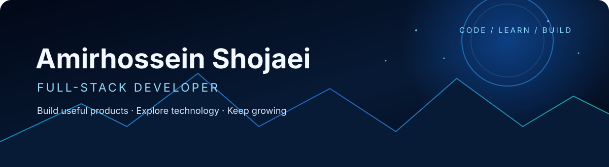

### Full-Stack Developer · Modern Web Applications · Shopify · DevOps

Building useful products, exploring technology, and continuously improving.

---

## `01 / About me`

I'm **Amirhossein Shojaei**, a Full-Stack Developer interested in building modern web products from interface to deployment.

I enjoy working across frontend and backend development, integrating third-party services, building Progressive Web Apps, and understanding the infrastructure that keeps applications running.

- Developing modern web applications with React, Next.js, JavaScript and TypeScript.
- Building backend services and API integrations with Node.js.
- Exploring Shopify embedded app development and storefront integrations.
- Working with containerized applications and deployment workflows.
- Experimenting with AI integrations and data-driven products.

---

## `02 / Technology`

<b>Frontend</b>

 

<b>Backend & APIs</b>

 

<b>Database, DevOps & Tools</b>

 

<b>Additional technologies to verify in project source</b>

 

Shopify App Bridge · Shopify Web Components · PM2 · APISIX · SeaweedFS · VAPID/Web Push · Service Workers · HLS

These are intentionally separated from the core icon stack until each implementation and level of hands-on use has been checked against the relevant project source.

---

## `03 / Selected work`

**Other work:** Hobo — a Shopify embedded AI chat and customer-support application; Elixia — a modern PWA platform. Add their verified public repository links here when available.

---

## `04 / GitHub analytics`

  
  

  

  

---

## `05 / Currently exploring`

- DevOps and production deployment
- System design and software architecture
- AI-powered application experiences
- Improving English communication

---

## `06 / Let's connect`

**KEEP CODING · KEEP GROWING**

Always learning. Always building.

