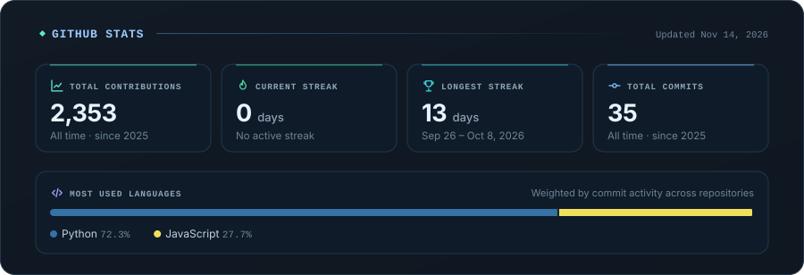

  

  I'm <b>Amirhossein Shojaei</b>, a Software Engineer interested in building modern web products from interface to deployment.
  I enjoy working across frontend and backend development, integrating third-party services, building Progressive Web Apps,
  and understanding the infrastructure that keeps applications running.

  

  

  

  Live:&nbsp; <a href="https://coup.davandegan.cloud/">Coup</a> &nbsp;·&nbsp; <a href="https://app.inotex.com">INOTEX</a> &nbsp;·&nbsp; <a href="https://myelixia.com/">Elixia</a>

  <picture>
    <source media="(prefers-reduced-motion: reduce)" srcset="https://raw.githubusercontent.com/amirhossein-shojaei/amirhossein-shojaei/output/contribution-snake-static.svg">
    
  </picture>

  

  

  

  

