  

  I'm <b>Amirhossein Shojaei</b>, a Software Engineer interested in building modern web products from interface to deployment.
  I enjoy working across frontend and backend development, integrating third-party services, building Progressive Web Apps,
  and understanding the infrastructure that keeps applications running.

  

  

  

  

  

  <picture>
    <source media="(prefers-color-scheme: dark)" srcset="https://raw.githubusercontent.com/amirhossein-shojaei/amirhossein-shojaei/output/github-snake-dark.svg">
    <source media="(prefers-color-scheme: light)" srcset="https://raw.githubusercontent.com/amirhossein-shojaei/amirhossein-shojaei/output/github-snake.svg">
    
  </picture>

  

  

  

